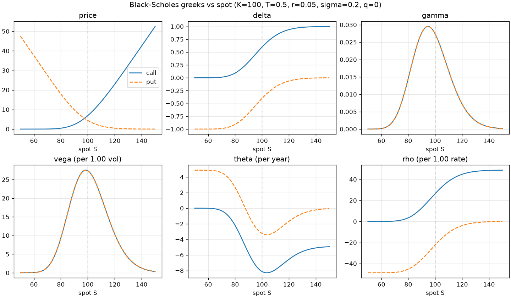
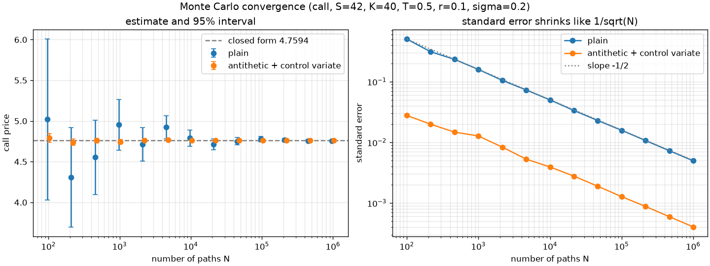
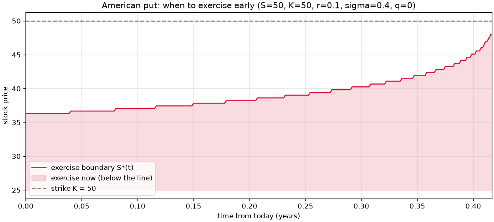
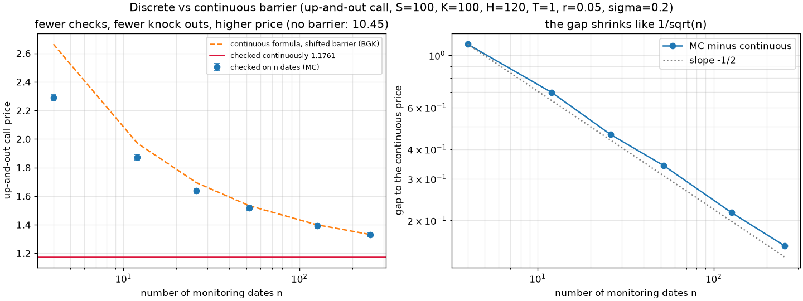
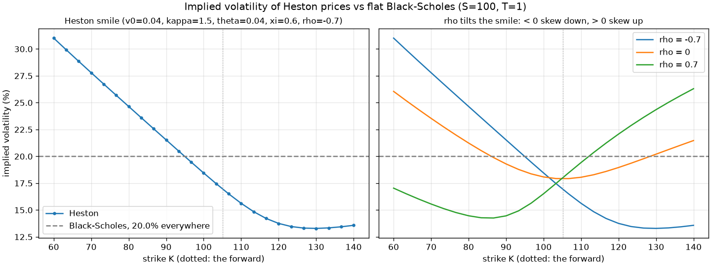
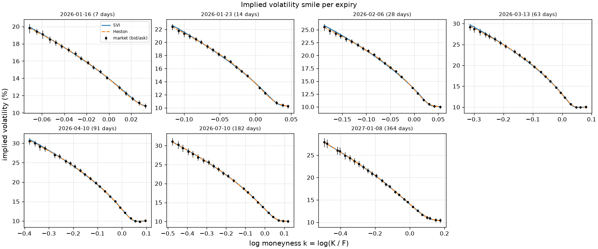
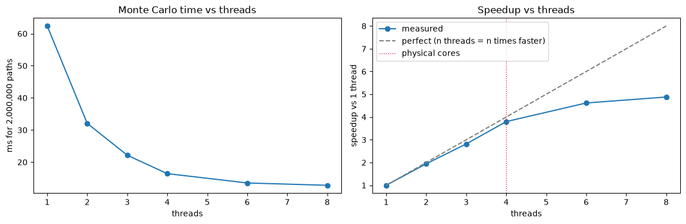

# Options Pricing Engine

[](https://github.com/JadBghiel/options-pricing-engine/actions/workflows/ci.yml)
[](https://codecov.io/gh/JadBghiel/options-pricing-engine)

An options pricing library built tier by tier: closed-form Black-Scholes, Monte Carlo, trees and
PDEs for American options, a multithreaded C++ core, exotics and stochastic volatility,
calibration to real option chains, and finally the risk of option strategies priced on that
surface.

I validated every tier of this project with a known reference (textbook value, analytical limit, or a
slower method that is already trusted).

I documented my full learning process in Notion, reach out privately if you wish to consult it.

> **Status:** Tiers 0 to 6 are built and validated: Black-Scholes with Greeks and
> implied vol, Monte Carlo with variance reduction, American options by binomial tree and
> Crank-Nicolson PDE, a multithreaded C++20 core that matches the Python to rounding, exotic
> options (Asian, barrier, lookback) plus the Heston stochastic volatility model, and
> calibration to SPX option chains (implied forwards, SVI, Heston).
> 378 Python tests (99% branch coverage) and 20 C++ tests, clean under ASan, UBSan and TSan.
> CI runs the tests, the notebooks and the C++ suite under the sanitizers on every push.
> Write-up: [docs/REPORT.md](docs/REPORT.md). **Tier 7 (a strategy risk lab and the MCP server) is next.**

**Quickest tour:** the [6 notebooks](notebooks/) (Tiers 1 to 6), the [REPORT](docs/REPORT.md) and the
[validation table](#validation).

---

## Why I built it

I'm a software engineering student aiming for quantitative research and development roles, and
I've been interested in option pricing for a while, so I decided to dig deeper into it.

The split I made between Python and C++ is deliberate, Python is for fast iteration on the maths and
the calibration. C++ is for the hot paths, exposed back to Python through pybind11, with
benchmarks that say when the port was worth it.

## How it fits with QuantDesk

This engine is a **library**: numerical methods and performance, in Python and C++. It comes with a CLI
and plots. My other project, **[QuantDesk](https://github.com/JadBghiel/quant-desk)** (a custom made harness for quantitative research), is the
interface: in the 7th tier this repo gains a small MCP server so QuantDesk can call `price_option`,
`greeks`, `implied_vol` and `strategy_risk`. The two projects can be used independently though.

---

## Roadmap

After some planning and defining the scope of this project I've organized it into 7 tiers, where each one builds on top of the previous. Tiers 0 to 3 are the core engine, 4 to 7 are complementary but interesting nonetheless.

This project took me several months, and in each tier I went back and forth on some decisions, but the final ones are documented in their own notebook in [notebooks/](notebooks/), an overview of the tier (key formulas, plots and small experiments) that is quicker to read than the code.

- [x] **Tier 0: Engineering setup.** `src/` layout, ruff, mypy strict, pytest with coverage, CI
      on every push. *Pass: a fresh clone installs and passes CI.*
- [x] **Tier 1: Black-Scholes closed form.** European prices, put-call parity, analytical Greeks,
      implied volatility (Newton with a bisection fallback). *Pass: Hull's example,
      Greeks match finite differences, implied vol round-trips.*
- [x] **Tier 2: Monte Carlo.** Exact GBM simulation, standard errors and 95% confidence
      intervals, antithetic and control variates, Monte Carlo Greeks three ways. *Pass: the
      Tier 1 price falls inside the confidence interval.*
- [x] **Tier 3: American options.** Cox-Ross-Rubinstein tree, Crank-Nicolson PDE solver with
      PSOR, early-exercise boundary. *Pass: tree and PDE agree, and both converge to Tier 1 on
      European payoffs.*
- [x] **Tier 4: C++ core.** Black-Scholes, Monte Carlo and the tree in C++20 with pybind11,
      multithreaded Monte Carlo, sanitizers in CI, benchmarks. *Pass: identical results to
      Python within floating-point tolerance.*
- [x] **Tier 5: Exotics and stochastic volatility.** Asian, barrier and lookback options, and the
      Heston model. *Pass: the geometric Asian matches its closed form; Heston converges to
      Black-Scholes as vol-of-vol goes to zero.*
- [x] **Tier 6: Calibration to market data.** Real option chains (IBKR, read-only, with yfinance
      as fallback), an implied volatility surface, SVI per maturity, Heston calibration.
      *Pass: fit errors per maturity, reproducible from a cached snapshot.*
- [ ] **Tier 7: Strategy risk lab and an MCP server.** Option strategies described in a small
      file (straddle, iron condor, spreads...) priced on the calibrated surface: their Greeks,
      a full-revaluation scenario grid, historical VaR and expected shortfall, and the MCP
      server for QuantDesk. It never reads positions or account data. *Pass: Greeks match
      finite differences, delta-gamma vs. full revaluation shows where it breaks, and the MCP
      tools are callable.*

The engine doesn't place or modify orders. The IBKR gateway code is read only, you can safely connect yours (see the
[Interactive Brokers disclaimer](#interactive-brokers-disclaimer)).

---

## Validation

| Tier | Compared with |
|---|---|
| 0 | A fresh clone installs and passes CI (lint, types, tests) |
| 1 | Hull's example (S=42, K=40, r=10%, σ=20%, T=0.5): call ≈ 4.76, put ≈ 0.81. Greeks vs. finite differences to 1e-4. Implied vol round-trip to 1e-6. Put-call parity |
| 2 | The Tier 1 price inside the 95% confidence interval about 95% of the time (checked over 200 seeds per method). Reported standard errors match the real spread across seeds. Variance reduction cuts the standard error 2x to 12x at equal N. Monte Carlo deltas (three ways) vs. the analytical delta within their standard error |
| 3 | Tree and PDE converge to Tier 1 on European payoffs (1e-4 and second order). American puts from tree and PDE agree to 0.05% of the price. American call on a non-dividend stock equals the European call; with an 8% dividend yield early exercise is worth 2.54 |
| 4 | The Python implementation on identical inputs: 1e-11 relative on 100,000 random options (largest gap 1.1e-13), the same tree to 1e-13, the same Monte Carlo on the same normals to 1e-11. The C++ generator matches NumPy's Philox bit for bit, and a seed gives the same bits on 1 to 8 threads. Clean ASan, UBSan and TSan builds |
| 5 | Every closed form compared with a simulation of the same contract, with the 95% interval holding it 92 to 96% of the time over 200 seeds: the geometric Asian, the continuous barrier and lookback (Brownian bridge), and the Heston semi-analytical price vs. full-truncation Monte Carlo. The semi-analytical price matches an independent integral (Lewis) to 1e-7, and Heston converging linearly to Black-Scholes as vol-of-vol goes to zero (gap 3e-5 at 1e-4) |
| 6 | A synthetic SPX-like chain priced by the library with known parameters and planted bad quotes: every bad quote caught by its own filter, the forward within 1 bp, SVI and Heston recovering their parameters (Heston from all 8 starting points). On a real SPXW snapshot: fit errors per maturity, and the same numbers bit for bit when rerun from the cached snapshot |
| 7 | A strategy's Greeks compared with the sum of its legs and with finite differences on the full revaluation. Delta-gamma vs. full revaluation, with its error where it breaks. VaR and expected shortfall rerun from cached history. The MCP tools are listed and callable from the MCP inspector |

---

## Tech stack

| Layer | Choice |
|---|---|
| Library | Python 3.12, NumPy, SciPy (typed with scipy-stubs), full type hints |
| Tooling | uv (environment and lockfile), scikit-build-core (build backend: runs CMake, compiles the C++ core) |
| Quality | ruff (lint and format), mypy strict, pytest with coverage, GitHub Actions, Codecov |
| Performance core | C++20, CMake, pybind11, scikit-build-core |
| C++ testing and speed | GoogleTest, Google Benchmark, pytest-benchmark, ASan, UBSan and TSan |
| Analysis | matplotlib (plots); the calibration itself is NumPy and SciPy only |
| Market data | IBKR API through ib_async, read-only, cached and paced; yfinance as fallback (both in the optional `market` extra) |
| Integration | an MCP server (Tier 7) for QuantDesk |

---

## Getting started

Needs [uv](https://docs.astral.sh/uv/), Python 3.12 and a C++20 compiler (GCC 11+ or Clang 14+).
Installing compiles the C++ core; CMake and pybind11 are fetched automatically if missing.

```bash
git clone https://github.com/JadBghiel/options-pricing-engine.git
cd options-pricing-engine
uv sync --all-extras
uv run pytest
```

The first `uv sync` compiles the C++ core (a minute or two), and the full `uv run pytest` takes
about 3 to 4 minutes: nothing is stuck.

Plain pip works too: `python -m venv .venv && source .venv/bin/activate && pip install -e ".[dev,plots]"`.

Checks that CI runs on every push:

```bash
uv run ruff check .
uv run ruff format --check .
uv run mypy
uv run pytest
uv run pytest --nbmake notebooks --no-cov  # every notebook, top to bottom
cmake -S . -B build/cpp -DOPE_BUILD_TESTS=ON && cmake --build build/cpp && ctest --test-dir build/cpp
```

The C++ tests also run in CI under ASan + UBSan and under TSan.

## Usage

`uv run ope --help` lists all 19 commands; each tier below shows its main ones.

### Tier 1: Black-Scholes

```python
from ope import call_price, greeks, implied_vol

call_price(42, 40, 0.5, 0.10, 0.20)  # 4.7594 (S, K, T, r, sigma, q=0)
greeks("call", 49, 50, 20 / 52, 0.05, 0.20)  # delta 0.522, gamma 0.066, vega 12.1, ...
implied_vol("put", 0.8086, 42, 40, 0.5, 0.10)  # 0.2000
call_price(100, [90, 100, 110], 1, 0.03, 0.2)  # NumPy arrays broadcast: a whole chain in 1 call
```

```bash
uv run ope price -S 42 -K 40 -T 0.5 -r 0.1 --sigma 0.2
uv run ope iv --type put -S 42 -K 40 -T 0.5 -r 0.1 --price 0.8086
uv run ope plot-greeks -K 100 -T 0.5 -r 0.05 --sigma 0.2 --out greeks.png
```

**Walkthrough:** [notebooks/tier1_black_scholes.ipynb](notebooks/tier1_black_scholes.ipynb), from
Hull's example piece by piece to Newton's steps drawn on the price curve. Every tier gets one, and
CI runs them all.

Conventions: `r`, `q` and `sigma` annualized and continuously compounded, `T` in years. Vega and
rho per 1.00 (divide by 100 for one point), theta per year (divide by 365 for one day), as in Hull.



Implied vol uses a safeguarded Newton (Newton steps inside a bracket, bisection when a step would
leave it). Near the money it needs 3 to 6 iterations where bisection needs about 40.

### Tier 2: Monte Carlo

```python
from ope import mc_delta, mc_price

res = mc_price("call", 42, 40, 0.5, 0.10, 0.20, n_paths=100_000, rng=0)
res.estimate, res.std_error, res.ci95  # price, its standard error, 95% interval

# variance reduction: antithetic pairs (z, -z) and a control variate on the stock
mc_price("call", 42, 40, 0.5, 0.10, 0.20, antithetic=True, control_variate=True, rng=0)

# delta three ways: "bump" (common random numbers), "pathwise", "likelihood_ratio"
mc_delta("call", 42, 40, 0.5, 0.10, 0.20, method="pathwise", rng=0)
```

```bash
uv run ope mc -S 42 -K 40 -T 0.5 -r 0.1 --sigma 0.2 --antithetic --control
uv run ope plot-mc -S 42 -K 40 -T 0.5 -r 0.1 --sigma 0.2 --out convergence.png
```

**Walkthrough:** [notebooks/tier2_monte_carlo.ipynb](notebooks/tier2_monte_carlo.ipynb): one
simulated future step by step, 100 confidence intervals drawn, both variance-reduction tricks,
the three deltas, and Sobol points vs. pseudo-random numbers.



Variance reduction on Hull's call (S=42, K=40, T=0.5, r=10%, σ=20%), 200,000 paths, same seed:

| Method | Standard error | Cut vs. plain | Equivalent extra paths |
|---|---|---|---|
| Plain | 0.0111 | 1x | 1x |
| Antithetic | 0.0055 | 2.0x | 4x |
| Control variate (discounted stock) | 0.0031 | 3.6x | 13x |
| Both | 0.0009 | 12.3x | 150x |

Monte Carlo delta, same option, 200,000 paths: bump-and-revalue with common random numbers and
pathwise both give a standard error of 0.0011; likelihood ratio gives 0.0037, about 3.5 times
noisier, because it weights whole payoffs by a random score instead of differentiating them.

### Tier 3: American options

```python
from ope import crr_price, pde_price, pde_solve

crr_price("put", 50, 50, 5 / 12, 0.10, 0.40, steps=2000, american=True)  # binomial tree, 4.2839
pde_price("put", 50, 50, 5 / 12, 0.10, 0.40, american=True)  # Crank-Nicolson + PSOR, 4.2835
pde_solve("put", 50, 50, 5 / 12, 0.10, 0.40, american=True).boundary  # early exercise boundary
```

```bash
uv run ope american --type put -S 50 -K 50 -T 0.4167 -r 0.1 --sigma 0.4
uv run ope plot-boundary --type put -S 50 -K 50 -T 0.4167 -r 0.1 --sigma 0.4 --out boundary.png
```

**Walkthrough:** [notebooks/tier3_american.ipynb](notebooks/tier3_american.ipynb): a 5-step tree
drawn with its early-exercise nodes, the backward step by hand, the odd/even zigzag, the PDE's
convergence, why the first PDE steps are implicit, the exercise boundary, and calls with and
without dividends.



American puts, binomial tree (average of 2000 and 2001 steps) vs. PDE (300 x 300 grid):

| Option | Tree | PDE | Gap | European | Early exercise premium |
|---|---|---|---|---|---|
| Hull's put (S=50, K=50, T=5m, r=10%, σ=40%) | 4.2844 | 4.2830 | 0.033% | 4.0760 | 0.2084 |
| Tier 1 put (S=42, K=40, T=0.5, r=10%, σ=20%) | 0.9102 | 0.9100 | 0.021% | 0.8086 | 0.1016 |
| Out of the money (S=100, K=110, T=1, r=5%, σ=25%) | 13.7432 | 13.7418 | 0.010% | 12.6616 | 1.0815 |
| With dividends (S=100, K=90, T=2, r=3%, σ=30%, q=2%) | 10.3829 | 10.3794 | 0.034% | 10.1774 | 0.2055 |

The first two PDE time steps are replaced by four implicit half-steps (Rannacher): without them,
gamma read off the grid at the strike comes out as 5.1 instead of 0.039 on a 25-step run.

### Tier 4: C++ core

The C++ versions live in `ope.cpp`, with the same names and signatures as the Python ones.

```python
import ope
from ope import cpp

cpp.price("call", 42, 40, 0.5, 0.10, 0.20)  # 4.7594, computed in C++
cpp.crr_price("put", 50, 50, 5 / 12, 0.10, 0.40, steps=2000, american=True)  # 4.2839, 30x faster
cpp.mc_price("call", 42, 40, 0.5, 0.10, 0.20, n_paths=10_000_000, rng=0, threads=8)

# C++ can't reproduce NumPy's random stream, so both sides are checked on the same normals
z = cpp.normals(1_000_000, rng=0)  # the draws cpp.mc_price(rng=0) uses
ope.mc_price_from_normals("call", 42, 40, 0.5, 0.10, 0.20, z=z)  # 4.760963344692207
cpp.mc_price_from_normals("call", 42, 40, 0.5, 0.10, 0.20, z=z)  # 4.7609633446922075
```

```bash
uv run ope mc -S 42 -K 40 -T 0.5 -r 0.1 --sigma 0.2 --paths 10000000 --cpp --threads 8
cmake -S . -B build/cpp -DOPE_BUILD_TESTS=ON && cmake --build build/cpp && ctest --test-dir build/cpp
```

**Walkthrough:** [notebooks/tier4_cpp_core.ipynb](notebooks/tier4_cpp_core.ipynb): Python and C++
side by side and why they differ in the last bits, the Philox generator compared bit for bit with NumPy,
the same price for any thread count, the thread scaling, and where the time goes.

The Monte Carlo runs on any number of threads and gives the same bits for a given seed: normal
number i always comes from the same Philox block, and the paths are summed in fixed chunks that
are merged in order.

### Tier 5: Exotics and Heston

```python
from ope import HestonParams, asian_mc, barrier_mc, barrier_price, heston_implied_vol, heston_mc
from ope import heston_price, lookback_price

# arithmetic Asian on 12 monthly averages, the geometric Asian as control variate
asian_mc("call", 100, 100, 1, 0.05, 0.2, n_dates=12, control_variate=True, rng=0)  # 6.1567

# up-and-out call: checked daily vs watched continuously
barrier_mc("call", 100, 100, 120, 1, 0.05, 0.2, kind="up-and-out", n_dates=252, rng=0)  # 1.3241
barrier_price("call", 100, 100, 120, 1, 0.05, 0.2, kind="up-and-out")  # 1.1761 continuous
barrier_price("call", 100, 100, 120, 1, 0.05, 0.2, kind="up-and-out", n_dates=252)  # 1.3321 BGK
lookback_price("call", 100, 1, 0.05, 0.2)  # 17.2168, floating strike

# Heston: v0, kappa, theta, xi (vol of vol), rho
p = HestonParams(v0=0.04, kappa=1.5, theta=0.04, xi=0.6, rho=-0.7)
heston_price("call", 100, 100, 1, 0.05, p)  # 9.8713, characteristic function
heston_mc("call", 100, 100, 1, 0.05, p, n_steps=64, rng=0)  # full-truncation Euler
heston_implied_vol(100, [80, 100, 120], 1, 0.05, p)  # 24.6%, 18.5%, 13.8%: the skew
```

```bash
uv run ope asian -S 100 -K 100 -T 1 -r 0.05 --sigma 0.2
uv run ope barrier -S 100 -K 100 -T 1 -r 0.05 --sigma 0.2 -H 120 --kind up-and-out
uv run ope heston -S 100 -K 100 -T 1 -r 0.05 --v0 0.04 --kappa 1.5 --theta 0.04 --xi 0.6 --rho -0.7
uv run ope plot-smile -S 100 -T 1 -r 0.05 --out smile.png
```

**Walkthrough:** [notebooks/tier5_exotics_heston.ipynb](notebooks/tier5_exotics_heston.ipynb): paths
instead of end points, the geometric control variate, a barrier crossed between two checks, the
Heston paths and full truncation, the branch-cut trap drawn, bias vs. noise, and the smile.

The geometric Asian's control variate cuts the standard error **36x** at equal paths (the
arithmetic and geometric payoffs of a path have a correlation of 0.9996), worth about 1,300 times
the paths.

**Discrete vs. continuous monitoring.** A barrier checked on dates misses the crossings in
between, so it knocks out less and is worth more. The continuous closed form is the wrong
reference for a contract checked daily:

| Up-and-out call (S=100, K=100, H=120, T=1, r=5%, σ=20%) | Checked on n dates (MC, 1M paths) | BGK approximation | Gap to continuous |
|---|---:|---:|---:|
| n = 12 (monthly) | 1.8495 ± 0.0041 | 1.9706 | +57% |
| n = 52 (weekly) | 1.5031 ± 0.0037 | 1.5328 | +28% |
| n = 252 (daily) | 1.3228 ± 0.0034 | 1.3321 | +12.5% |
| continuous (closed form) | 1.1761 | | |

The gap shrinks like 1/√n. The down-and-out call at H=90 is less sensitive (+3.2% daily),
because it dies where its payoff is small.



**Heston.** The Monte Carlo has a bias from its time step that more paths don't remove: +1.14
at 2 steps a year, about +0.03 at 64, on a call worth 9.8713. With the vol of vol violating the
Feller condition, the Euler variance goes negative on 8% to 37% of steps; full truncation uses
max(v, 0) wherever v is needed. The semi-analytical price uses the "Little Heston Trap" form:
Heston's original formula prices a 5-year call at 16.39 instead of 29.09, because its complex
logarithm jumps across a branch cut.



### Tier 6: Calibration to market data

From a chain of option quotes to a volatility surface: clean the quotes, imply each expiry's
forward from put-call parity (no r or q assumed), invert the mids, fit SVI per expiry with
butterfly and calendar arbitrage checks, and calibrate Heston to every expiry at once.

```python
import ope

chain = ope.load_snapshot("tests/fixtures/spx_synthetic.csv")  # or a snapshot you pulled
surface = ope.iv_surface(chain)  # cleaned, forwards from parity, implied vols
print("\n".join(surface.report.lines()))  # how many quotes each filter removed: 153 kept of 420
surface.forwards["20270108"].F  # 5161.85, the 1 year forward (true value 5162.13)

fits = ope.fit_svi_surface(surface)  # 1 SVI per expiry, butterfly and calendar checked
fits[0].rms, fits[0].min_g  # 0.061 vol points, g(k) >= 0: no butterfly arbitrage
cal = ope.calibrate_heston(surface)  # 8 seeded starting points, about 3 s
cal.params  # v0 0.0200, kappa 2.48, theta 0.0351, xi 0.797, rho -0.751 (true: 0.02, 2.5, 0.035, 0.8, -0.75)
```

```bash
uv run ope surface tests/fixtures/spx_synthetic.csv     # the cleaning report and the forwards
uv run ope svi tests/fixtures/spx_synthetic.csv         # SVI fit error per expiry, arbitrage checks
uv run ope calibrate tests/fixtures/spx_synthetic.csv   # Heston params, Feller, error per expiry
uv run ope plot-surface tests/fixtures/spx_synthetic.csv --out smiles.png
```

**Walkthrough:** [notebooks/tier6_calibration.ipynb](notebooks/tier6_calibration.ipynb): a raw
chain and its junk, the cleaning report, parity as a straight line, what a wrong forward does to
the smile, SVI and its arbitrage checks, the Heston calibration from 8 starts, and the term
structure of the skew.

**About the data.** The library pulls real option chains, but **this repository publishes no real
market data.** The Interactive Brokers market data agreement doesn't allow passing quotes on, so
real snapshots stay in the git-ignored `data/` folder, and the tests, the notebook and CI run on
a synthetic SPX-like chain that the library prices itself (Heston with known parameters, bid-ask
spreads, prices rounded to the tick, and a few broken quotes of each kind). You can pull your
own real chains with your own account, as below.

**Connecting your own IB Gateway (read-only).**
1. Install the extra: `uv sync --extra market` (ib_async and yfinance).
2. In IB Gateway or TWS: Configure → Settings → API → Settings. Tick **Read-Only API**, tick
   **Allow connections from localhost only**, check that `127.0.0.1` is in the trusted IPs, and
   note the **Socket port** (IB's defaults: 4001 Gateway live, 4002 Gateway paper, 7496 TWS live,
   7497 TWS paper).
3. Pull a snapshot, giving your port as a flag or an environment variable (there is no default
   port, so nothing connects until you choose one):

```bash
uv run ope fetch-chain --source ibkr --port 4002          # or: export OPE_IB_PORT=4002
uv run ope calibrate data/chains/spx_ibkr_<date>_<time>.csv
```

The fetcher does the API handshake and nothing more (no positions, orders or account data are
requested), locks the connection read-only on its side as well (see the
[Interactive Brokers disclaimer](#interactive-brokers-disclaimer)), uses streaming market data
requests (the billed snapshot requests are never sent), stays at 50 quotes at a time, and writes
every batch to `data/chains/` before anything reads it: with the market closed, a rerun after a
disconnect asks for the missing batches and nothing else. Without a market data subscription
IBKR returns delayed data, which works the same. `--source yfinance` (or `auto`, the default, when no port is given or no gateway
answers) uses Yahoo instead.

**On a real SPXW snapshot** (IBKR delayed data, close of 23 October 2026, 8 expiries from 7 to
342 days, 158 quotes kept of 392), run locally:

| Days to expiry | 7 | 14 | 31 | 56 | 84 | 159 | 250 | 342 |
|---|---:|---:|---:|---:|---:|---:|---:|---:|
| SVI rms error (vol points) | 0.39 | 0.13 | 0.09 | 0.09 | 0.11 | 0.14 | 0.04 | 0.003 |
| Heston rms error (vol points) | 2.57 | 1.82 | 0.89 | 1.03 | 1.17 | 1.11 | 0.29 | 0.07 |

SVI fits every expiry with no butterfly or calendar arbitrage on the quoted strikes. Heston (v₀ =
0.0287, κ = 4.80, θ = 0.0503, ξ = 1.78, ρ = −0.687, Feller violated) fits the long end and misses
the steep one-week skew: with no jumps, its variance can't move fast enough. The whole calibration
takes 4 to 7 seconds and gives the same parameters bit for bit when rerun from the snapshot.



---

## Interactive Brokers disclaimer

If you clone this repository and connect it to your own Interactive Brokers account, read this
first.

- Tick **Read-Only API** in IB Gateway or TWS (Configure → Settings → API → Settings). The code
  sends no orders, and `connect_ibkr` also locks the connection on its side
  ([src/ope/ib_gateway.py](src/ope/ib_gateway.py)): every order, position and account method
  raises an error. The gateway setting is the check IBKR enforces itself, so keep it on.
- Start with a paper account (port 4002 for IB Gateway, 7497 for TWS) until you have read the
  code. There is no default port: the fetcher connects only when you pass `--port` or set
  `OPE_IB_PORT`.
- What it requests: the index and option contract details, the list of expiries and strikes,
  and streaming quotes for up to about 500 contracts, 50 at a time. No positions, orders,
  executions or account values. The account list the gateway sends during the handshake is
  dropped without being read.
- What it costs: streaming delayed data is free. Snapshot and regulatory snapshot requests are
  billed per request, so the library refuses them and a test checks it. Live quotes need a
  market data subscription on your account; without one, IBKR sends delayed data.
- Your quotes stay on your machine, in the git-ignored `data/` folder. The IBKR market data
  agreement doesn't allow passing them on, so don't commit or publish them.
- This is a learning project, provided as is under the [MIT license](LICENSE), with no warranty.
  How you use it with your account is your responsibility.

---

## Benchmarks

Median times from Python, Release build, on a 4-core laptop (Intel i5-1135G7, 8 hardware threads).
"NumPy" is the library itself, vectorized; pure Python loops are the floor. Reproduce
everything with one command: `bash benchmarks/run.sh` (full output in
[benchmarks/RESULTS.md](benchmarks/RESULTS.md)).

| Workload | Pure Python | NumPy | C++ 1 thread | C++ 8 threads | C++ vs. NumPy |
|---|---:|---:|---:|---:|---:|
| Black-Scholes, 100,000 calls | 44.8 ms | 7.7 ms | 7.2 ms | 2.5 ms | 3.1x |
| Monte Carlo, 1,000,000 paths | 582 ms | 35.6 ms | 37.5 ms | 11.4 ms | 3.1x |
| American put, CRR tree, 2,000 steps | 698 ms | 39.0 ms | 1.3 ms | n/a | 30x |

In the table:
- **The tree** is where C++ wins outright: the Python version pays the interpreter at each of the
  2,000 time steps, and C++ runs one tight loop on one array.
- **On one thread, C++ ties NumPy** for Black-Scholes and Monte Carlo, because NumPy's inner
  loops are compiled C too. For Monte Carlo, C++ prices about 2x faster from the same normals but draws
  its normals 2x slower (Philox and Box-Muller vs. NumPy's ziggurat), so it evens out.
- **Threads** bring the rest. The Monte Carlo speedup at 8 threads ranges from 2.9x to 5.1x across
  runs on this laptop: 4 physical cores, turbo that slows down as more cores work, and whatever
  else the machine is doing.



---

## Repository layout

```
src/ope/            Python library (models, Greeks, Monte Carlo, trees, PDE, calibration; strategy risk in Tier 7)
tests/fixtures/     the synthetic SPX-like chain snapshot the tests and the notebook run on
cpp/                C++20 core: headers, sources, pybind11 bindings, GoogleTest, Google Benchmark
CMakeLists.txt      builds the Python module (through scikit-build-core) or the C++ tests and benchmarks
tests/              validation tests for every tier, run on the Python and the C++ side
benchmarks/         pytest-benchmark suite, run.sh (one command for every number) and RESULTS.md
notebooks/          one walkthrough per tier: plots and experiments (run in CI)
docs/               the write-ups below, and docs/img/ for the plots in this README
.github/workflows/  CI
docs/NOTES.md       condensed notes per tier (key formulas, gotchas, takeaways)
docs/DECISIONS.md   what was picked and ruled out per tier, and why
docs/REPORT.md      technical write-up: methods, validation, convergence, limits
LICENSE             MIT
```

---

## References

Parts of this project are also based on external sources, such as books I read or Youtube videos I watched, non exhaustive list below

| Tier | Reading |
|---|---|
| 1 | Hull, *Options, Futures, and Other Derivatives*: the Black-Scholes-Merton model and the Greek letters. Joshi, *The Concepts and Practice of Mathematical Finance* |
| 2 | Glasserman, *Monte Carlo Methods in Financial Engineering* |
| 3 | Hull: binomial trees and numerical procedures. Wilmott, *Paul Wilmott Introduces Quantitative Finance* (finite differences) |
| 4 | Salmon et al., *Parallel Random Numbers: As Easy as 1, 2, 3* (2011, Philox). Chan, Golub and LeVeque, *Algorithms for Computing the Sample Variance* (1983). Box and Muller (1958) |
| 5 | Hull: exotic options. Heston (1993). Albrecher et al., *The Little Heston Trap* (2007). Lord, Koekkoek and van Dijk, *A Comparison of Biased Simulation Schemes for Stochastic Volatility Models* (2010, full truncation). Broadie, Glasserman and Kou, *A Continuity Correction for Discrete Barrier Options* (1997). Lewis, *Option Valuation under Stochastic Volatility* (2000) |
| 6 | Gatheral, *The Volatility Surface*. Gatheral and Jacquier, *Arbitrage-free SVI volatility surfaces* (2014). Lee, *The Moment Formula for Implied Volatility at Extreme Strikes* (2004) |

