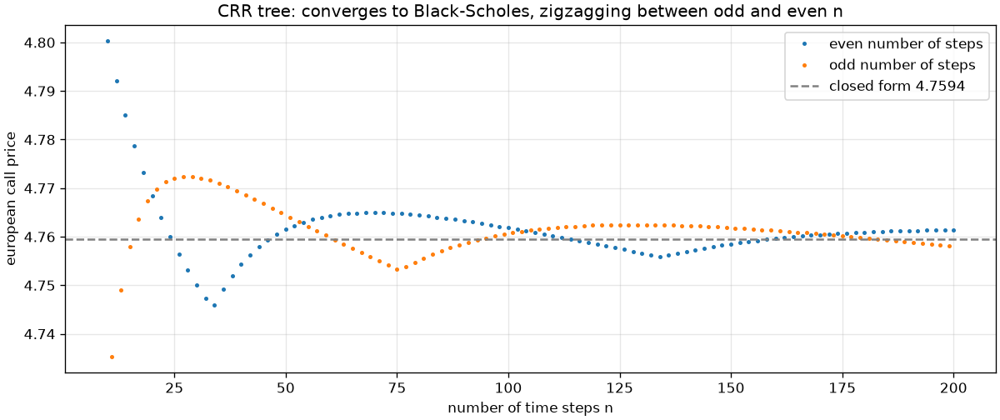
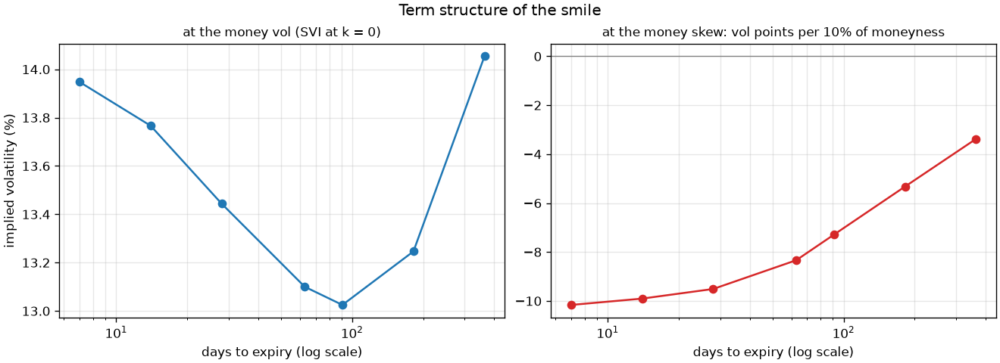

# Report: pricing European and American options four ways, in Python and C++, and calibrating to market data

A technical write-up of the core engine (Tiers 1 to 3), its C++ port (Tier 4) and the calibration
to option chains (Tier 6): what each method does, how it was validated, how it converges, what the
C++ core buys, and where it all stops being trustworthy. Tier 5's exotics and Heston model get a
short note (section 5) because they move the limits.

All numbers come from the code in this repository and can be reproduced with the commands and
notebooks referenced below. The reference case throughout is Hull's call, S = 42, K = 40,
T = 0.5, r = 10%, σ = 20%, worth 4.7594 in closed form.

## 1. Methods

| Method | Module | Prices | Idea |
|---|---|---|---|
| Closed form | `black_scholes.py` | European | Black-Scholes-Merton with a dividend yield, vectorized over NumPy arrays |
| Monte Carlo | `monte_carlo.py` | European (any simulable payoff later) | Exact one-step simulation of S_T, discounted average payoff |
| Binomial tree | `trees.py` | European and American | Cox-Ross-Rubinstein tree, backward induction with an early-exercise max |
| Finite differences | `pde.py` | European and American | Black-Scholes PDE in log price, Crank-Nicolson with a Rannacher start, PSOR for early exercise |

**Closed form.** Prices and the five Greeks come from one shared computation of d1, d2 and the
discount factors. Degenerate inputs (T = 0, σ = 0, S = 0) send d1 and d2 to ±∞, so the same
formulas return the intrinsic value on the forward with no special case. Implied volatility is a
safeguarded Newton method: Newton steps on vega inside a bracket that always contains the root,
with a bisection step whenever Newton would leave it, started at the point where vega peaks.

**Monte Carlo.** Under Black-Scholes, log S_T is exactly normal, so each path is one draw:
S_T = S·exp((r − q − σ²/2)T + σ√T·Z). The estimator reports a standard error and a 95% interval.
Two variance-reduction techniques are available together: antithetic pairs (Z, −Z), with the
standard error computed over pair averages, and a control variate on the discounted stock, whose
mean S·e^(−qT) is known, with the regression slope β. Delta is estimated three ways: bump and
reprice with common random numbers, pathwise, and likelihood ratio.

**Binomial tree.** u = e^(σ√Δt), d = 1/u, risk-neutral probability p = (e^((r−q)Δt) − d)/(u − d).
The backward step is vectorized per time slice; an American option takes the maximum of the
continuation value and the exercise value at every node.

**Finite differences.** In x = ln S the PDE has constant coefficients. The grid spans six standard
deviations around the spot and the strike, and is shifted so the strike sits on a node.
Time steps are Crank-Nicolson, except the first two, each replaced by two fully implicit half
steps (Rannacher) to damp the oscillations caused by the payoff's kink. European steps solve a
tridiagonal system directly; American steps solve the linear complementarity problem
V ≥ payoff by projected successive over-relaxation (PSOR, ω = 1.2). The early-exercise boundary
is read off the grid at every step.

## 2. Validation

Every reference value is recomputed by an independent script.

| Check | Result |
|---|---|
| Hull's call and put (closed form) | 4.7594 and 0.8086, to 1e-9 |
| Hull's Greeks example (S=49, K=50, T=20/52) | Δ 0.5216, Γ 0.0655, vega 12.105, Θ −4.305/yr, ρ 8.907, to 1e-8 |
| Put-call parity | 1e-10 on 500 random parameter sets |
| Greeks vs. central finite differences | 1e-4 relative on 200 random sets, calls and puts |
| Implied vol round trip | σ recovered to 1e-6 wherever vega > 1e-3; 20,000 random options, no failure |
| Monte Carlo 95% interval coverage | 93% to 96% over 400 seeds, for every variance-reduction setting |
| Monte Carlo standard error calibration | reported SE within 15% of the spread of estimates over 300 seeds |
| Monte Carlo deltas | every method within 4 standard errors of the analytical delta |
| European tree (2000/2001 steps averaged) | within 1e-4 of the closed form |
| European PDE (400 × 400) | within 5e-5 relative (2e-4 absolute floor) of the closed form |
| American put, tree vs. PDE (300 × 300) | agree to 0.05% of the price on four cases (largest gap 0.034%) |
| American call without dividends | equals the European call exactly on the tree, to 1e-6 on the PDE |
| Hull's 5-step American put | 4.4885, Hull's 4.49 |
| C++ vs. Python, Black-Scholes | 1e-11 relative on 100,000 random options; largest gap 1.1e-13 |
| C++ vs. Python, tree | 1e-13 relative; largest gap 8.5e-16 |
| C++ vs. Python, Monte Carlo on the same normals | 1e-11 relative; largest gap 3.7e-13 |
| C++ random numbers | Philox bit for bit vs. NumPy and Random123; same bits on 1 to 8 threads |

196 Python tests (99% branch coverage) and 20 C++ tests, run with lint, strict type checks, the
four notebooks and the C++ tests under AddressSanitizer, UndefinedBehaviorSanitizer and
ThreadSanitizer on every push. The Tier 1 to 3 tests that apply to a ported function run on both
implementations.

## 3. Convergence

**Monte Carlo** error falls like 1/√N: the standard error on a log-log plot follows a slope of
−1/2. Variance reduction lowers the line without changing its slope. At 200,000 paths on Hull's
call:

| Monte Carlo variant | Standard error | Cut vs. plain | Equivalent paths |
|---|---|---|---|
| Plain | 0.0111 | 1× | 1× |
| Antithetic | 0.0055 | 2.0× | 4× |
| Control variate | 0.0031 | 3.6× | 13× |
| Both | 0.0009 | 12.3× | 150× |

Delta: bump with common random numbers and pathwise both reach a standard error of 0.0011;
likelihood ratio 0.0037. Scrambled Sobol points (notebook only) reached an error of 0.00004 at
65,536 points against 0.019 for pseudo-random numbers.


**The binomial tree** converges like 1/n but zigzags between odd and even step counts, because
the strike falls at a different position between nodes. Averaging n and n + 1 steps removes most
of it: at 1000/1001 steps the European call is 4.759453 against 4.759422.



**The PDE** converges at second order: on the European put, the error is 3.2e-3 at
50 × 50 and 1.4e-5 at 800 × 800. The drops per doubling are irregular because the spot falls at a
different place between grid nodes; on average they are close to 4×. Without the Rannacher start,
gamma read off a 25-step grid at the strike is 5.1 instead of 0.039; with it, 0.0393.


## 4. The C++ core

**What was ported.** Black-Scholes (prices and Greeks, one option or a whole chain), the Monte
Carlo pricer and the CRR tree, in C++20 with CMake, exposed through pybind11 as `ope.cpp` with the
same signatures as the Python functions. scikit-build-core builds it from the same
`pyproject.toml`, always in Release, without `-ffast-math` and without fused multiply-add.

**Why the results differ in the last bits, and how they are compared.** The two sides use
different implementations of N(x) (`erfc` vs. SciPy's `ndtr`) and of `exp`, and add numbers in a
different order. Hull's call is 4.7594223928715316 in Python and 4.7594223928715422 in C++: 1.5
units in the last place of the 32.72 stock leg it is computed from. Every comparison uses 1e-11
relative with a 1e-12 absolute floor, about 10 times the largest gap measured.

**Random numbers for threads.** C++ can't reproduce NumPy's random stream, so for an exact check
both sides price the same pre-generated normals. The C++ generator is Philox 4x64-10, a
counter-based generator: normal number i is a pure function of the seed and i (block i/4 through
Box-Muller). The Monte Carlo cuts the draws into chunks of 16,384, each thread sums whole chunks,
and the chunks' means and centered sums are merged in chunk order (Chan, Golub and LeVeque). A
seed therefore gives the same bits on any number of threads, and Python can replay a C++ run from
`cpp.normals`.

**Benchmarks** (`bash benchmarks/run.sh`; medians from Python, Release build, Intel i5-1135G7,
4 cores and 8 hardware threads):

| Workload | Pure Python | NumPy | C++ 1 thread | C++ 8 threads | C++ vs. NumPy |
|---|---:|---:|---:|---:|---:|
| Black-Scholes, 100,000 calls | 44.8 ms | 7.7 ms | 7.2 ms | 2.5 ms | 3.1× |
| Monte Carlo, 1,000,000 paths | 582 ms | 35.6 ms | 37.5 ms | 11.4 ms | 3.1× |
| American put, CRR tree, 2,000 steps | 698 ms | 39.0 ms | 1.3 ms | n/a | 30× |

The comparison that matters is with NumPy; the Python loops are the floor. The tree gains 30×
because the Python version pays the interpreter at each of its 2,000 time steps. Black-Scholes and
Monte Carlo on one thread tie NumPy, whose inner loops are compiled C too. For Monte Carlo the tie
splits cleanly: from the same normals C++ prices about twice as fast, but its Box-Muller normals
(a log, a square root, a sine and a cosine per pair) cost about twice as much as NumPy's ziggurat.

**Thread scaling.** The Monte Carlo speedup at 8 threads ranged from 2.9× to 5.1× across runs on
this laptop: the 8 hardware threads share 4 physical cores, turbo slows as more cores work, and
other programs compete. Timings use wall-clock time; the CPU time of the main thread barely moves
while the workers run.


## 5. Exotics and Heston (Tier 5, short)

**Exotics.** Asian, barrier and lookback options are simulated date by date with the exact GBM log
step, so the monitoring dates are a contract term, with no discretization error. The arithmetic
Asian uses the geometric Asian (closed form) as control variate: 36x smaller standard error at
equal paths. Barrier and lookback have continuous closed forms, compared with Monte Carlo with
the Brownian bridge between dates (95% intervals hold them 92 to 96% of the time over 200 seeds).
Checked daily, the up-and-out call (S = K = 100, H = 120) is worth 1.3228 against 1.1761 watched
continuously: a 12.5% gap that shrinks like 1/√n and that the BGK shifted barrier predicts within
0.7%.

**Heston.** The semi-analytical price uses the characteristic function in the "Little Heston
Trap" form (Heston's original form gives 16.39 instead of 29.09 for a 5-year call), checked
against Lewis's integral to 1e-7. Full-truncation Euler Monte Carlo agrees with it within its
standard error at 64 steps; its bias is +1.14 at 2 steps and about +0.03 at 64. As the vol of vol
goes to zero, Heston converges linearly to Black-Scholes at the average volatility. With
ρ = −0.7 the implied volatility runs from 27.8% at K = 70 to 13.3% at K = 130.

## 6. Calibration to market data (Tier 6)

**The data.** SPXW options (S&P 500, European, cash-settled at the 4pm close on every expiry),
pulled read-only from Interactive Brokers through `ib_async`: the API handshake and nothing else (a lock on
the connection makes every order, position and account call raise), streaming
delayed data in batches of 50, every batch written to the git-ignored `data/` before it is read.
Real quotes stay out of git (the IBKR market data agreement): the tests, the notebook and CI
run on a synthetic SPX-like chain priced by the library (Heston v₀ = 0.02, κ = 2.5, θ = 0.035,
ξ = 0.8, ρ = −0.75; S = 5000, r = 4.5%, q = 1.3%), with tick-rounded bid-ask quotes and 29 planted
bad quotes of six kinds.

**Pipeline.**
1. *Cleaning*, each filter counted: no two-sided quote, crossed or locked, stale (when the source
   gives trade times), relative spread above 50%, no volume and an open interest known to be 0.
2. *The forward and discount factor per expiry* from put-call parity: C − P = D·F − D·K is a line
   in K, fitted by weighted least squares (weights 1 / spread), bad pairs removed one at a time.
3. *The surface*: mids outside the no-arbitrage bounds dropped; out-of-the-money mids, bids and asks
   inverted with the Tier 1 solver; each quote weighted by 1 / its bid-ask spread in vol.
4. *SVI* per expiry (raw form, 5 parameters, 12 starting points), fitted in vol space, with Lee's
   wing bound b(1 + |ρ|) ≤ 2 in every fit. Butterfly arbitrage (Gatheral and Jacquier's g(k) ≥ 0)
   and calendar arbitrage (total variance not decreasing in T) are checked on each expiry's quoted
   range plus 10%; a penalized refit happens when the plain fit breaks one.
5. *Heston* calibrated to every expiry at once: residuals = (model − mid) / vega ≈ vol error, times
   the weights; prices from one shared Gauss-Legendre grid per expiry (the characteristic function
   computed once on the nodes, nodes that follow the oscillation of e^(−iu·log(K/F))); 8 seeded
   Sobol starting points, all reported.

**Validation on the synthetic chain.**

| Check | Result |
|---|---|
| Planted bad quotes | each one removed by its own filter (checked by identity, not by counts) |
| Forward | within 1 bp of the truth at every expiry over 10 seeds; r and q within 0.1% past 1 month |
| Robust parity | over 10 seeds, the pairs dropped are exactly the planted garbage that reaches the regression |
| SVI, no noise | parameters back to 1e-6 |
| SVI, 0.3 vol points of noise | curve within 0.06 to 0.20 vol points rms of the truth; ρ itself moves by up to 0.2 |
| Shared grid vs. `heston_price` | within 1e-8 × F (1e-4 vol points), 0.7 to 1.6 ms per expiry vs. 4 to 9 ms per strike |
| Heston recovery | all 8 starts reach v₀ 0.0200, κ 2.48, θ 0.0351, ξ 0.797, ρ −0.751 in 2.7 s; rms 0.08 vol points, every model vol inside its bid-ask |

**On a real SPXW snapshot** (delayed data, close of 23 October 2026, 8 expiries from 7 to 342
days). Cleaning: 392 quotes, 62 without a two-sided quote, 4 too wide, 47 with no volume and no
open interest, 1 outside the bounds, 120 on the in-the-money side, **158 kept**. The implied rate
past 1 month: 4.6% to 5.2%. The index level IBKR returned was out of sync with the 16:15 option
quotes (with it the 1-week dividend yield would be −10%), which is why the forward comes from parity.

| Days to expiry | 7 | 14 | 31 | 56 | 84 | 159 | 250 | 342 |
|---|---:|---:|---:|---:|---:|---:|---:|---:|
| Quotes | 29 | 17 | 21 | 24 | 21 | 15 | 19 | 12 |
| SVI rms / max (vol points) | 0.39 / 1.79 | 0.13 / 0.41 | 0.09 / 0.25 | 0.09 / 0.22 | 0.11 / 0.25 | 0.14 / 0.22 | 0.04 / 0.08 | 0.003 / 0.004 |
| Heston rms / max (vol points) | 2.57 / 7.27 | 1.82 / 5.38 | 0.89 / 2.12 | 1.03 / 2.62 | 1.17 / 2.86 | 1.11 / 2.15 | 0.29 / 0.89 | 0.07 / 0.19 |
| At-the-money skew (vol points per 10% moneyness) | −12.3 | −11.2 | −9.0 | −7.1 | −6.1 | −4.4 | −4.1 | −3.5 |

SVI: no butterfly arbitrage on any quoted range (min g ≥ 0.12), no calendar crossing, no penalized
fit. Heston: all 8 starts reached v₀ = 0.0287 (16.9% vol), κ = 4.80, θ = 0.0503 (22.4% vol),
ξ = 1.78, ρ = −0.687; the Feller condition is violated (2κθ = 0.48 against ξ² = 3.15), as in most
index calibrations. 4 to 7 s, and the same parameters bit for bit when rerun from the snapshot.

**Reading it.** One set of Heston parameters fits the long end to a tenth of a vol point and
misses the one-week skew by up to 7 vol points. Heston's skew levels off at short maturities (−10.2
at 1 week, −9.5 at 1 month on the synthetic chain) while the market's keeps steepening (−12.3 at 1
week): a diffusion can't move the variance fast enough over a few days. SVI, which fits each expiry
on its own, has no such constraint.




## 7. Limits

- **The model.** Tiers 1 to 4 assume constant volatility, no jumps and frictionless continuous
  hedging. Heston (Tier 5) produces a smile but has no jumps: calibrated to SPX (Tier 6) it misses
  the one-week skew by up to 7 vol points. Jumps (Bates) or rough volatility address it.
- **Monte Carlo has no early exercise.** Exotics and Heston are European-style: American options by
  simulation need regression methods (Longstaff-Schwartz), not implemented.
- **Heston Monte Carlo is first order in the time step.** The bias is measured, not removed: choose
  the steps for the precision needed (64 steps leave about 0.3% on a 1-year at-the-money call).
  Andersen's QE scheme would cut it per step.
- **Heston's semi-analytical price** is one adaptive integral pair per strike (4 to 9 ms): fine for
  validation, slow for calibration, which uses the shared grid instead (0.7 to 1.6 ms per expiry).
  Prices under about 1e-9 are integration noise, and below ξ ≈ 1e-5 the formula loses digits.
- **Barriers:** single knock-out barriers only (knock-ins via in-out parity), and the BGK shift
  is an approximation (within 1% of daily monitoring in the tests).
- **Implied volatility is scalar** and, far out of the money and close to expiry, Newton barely
  beats bisection. Inverting a whole real chain (about 500 inversions with the bids and asks)
  takes well under a second, so it was not worth vectorizing in Tier 6.
- **The calibration data.** The fetcher picks about 8 expiries and 30 strikes each, so the real
  surface has 12 to 29 quotes per expiry; IBKR's delayed-frozen data carries no trade times, so the
  stale filter can't act on it; open interest can arrive after the quote (the fetcher now waits for
  it). Exchange holidays are not in the session calendar.
- **SVI is checked, not guaranteed.** Raw SVI per expiry can still have arbitrage outside the
  quoted range (reported as a flag), and its 5 parameters are weakly identified on a narrow range:
  the curve is reliable, ρ and m on their own are not. SSVI (a surface-wide parametrization with
  arbitrage-free conditions) is the next step.
- **Heston calibration** weights every quote equally per unit of bid-ask spread, so the expiries
  with many tight quotes count most. Its local minima did not show up here (all 8 starts agreed),
  but nothing guarantees it on another day.
- **PSOR is pure Python.** An American PDE price takes about 1.3 to 1.5 s on a 400 × 400 grid. Tier 4
  ported Black-Scholes, Monte Carlo and the tree (its stated scope); the PDE is the next port.
- **C++ normals are slower than NumPy's.** Box-Muller costs about 2× NumPy's ziggurat, so a
  single-threaded C++ Monte Carlo ties NumPy. A ziggurat sampler is the next speed-up.
- **Thread scaling numbers are machine-dependent** and noisy on a laptop; the benchmarks report
  medians and the README gives the range seen.
- **The exercise boundary is grid-resolution limited:** it moves in steps of one grid node, so
  it looks like a staircase unless the grid is fine.
- **Discrete dividends** are not modelled, only a continuous yield q.

## 8. Reproduce

```bash
uv sync --all-extras                            # also compiles the C++ core (needs a C++20 compiler)
uv run pytest                                   # 378 tests, Python and C++
uv run pytest --nbmake notebooks --no-cov       # the six walkthrough notebooks
cmake -S . -B build/cpp -DOPE_BUILD_TESTS=ON && cmake --build build/cpp && ctest --test-dir build/cpp
bash benchmarks/run.sh                          # every benchmark number, then benchmarks/RESULTS.md
uv run ope mc -S 42 -K 40 -T 0.5 -r 0.1 --sigma 0.2 --antithetic --control
uv run ope american --type put -S 50 -K 50 -T 0.4167 -r 0.1 --sigma 0.4
uv run ope calibrate tests/fixtures/spx_synthetic.csv   # Tier 6 on the synthetic chain
uv run ope fetch-chain --source ibkr --port 4001        # your own snapshot (read-only gateway)
```
